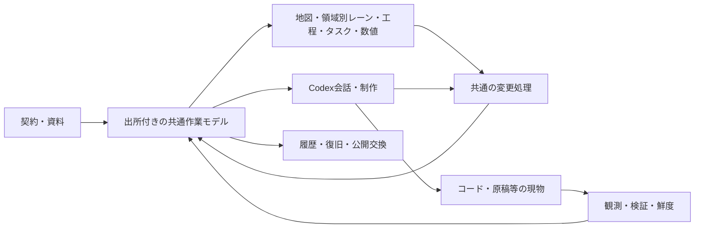

# DESIGN STANDARD — Mindwise Rebuild

- **共通契約リビジョン**: Mindwise Rebuild Rev 2
- **状態**: ACTIVE（2026-10-25のレビュー・修正委譲により補正。個人用ChatGPTの既存枠内で新ルート試験資料を使う実装・検証GO）
- **策定日**: 2026-10-25
- **対応**: 新ルートのGOAL.md。旧ルートのRev 4は本書の正典ではない。

## 1. 体験を支える全体構造

Mindwise自身が作業画面と共通の作業モデルを持つ。人の直接操作とCodexの操作は同じ変更口へ入り、その結果を各表示が参照する。外側の別マップを編集して都度照合することを通常運転の中心にしない。

常時すべてを一画面へ詰め込む必要はない。同じ作業空間のタブ・シート・詳細表示でも、同じIDと対象範囲で行き来できればよい。選択中の対象・会話・表示の対応を明示し、全体から詳細へ戻る経路を保つ。

| 正本 | 責任 |
|---|---|
| 新ルートのGOAL／DESIGN_STANDARD | 要求・設計・品質・権限。承認後は変更案と承認を経て改訂 |
| DISCOVERY_LOG | オーナー発言、資料、採用／却下、承認の由来。契約に優越しない |
| 共通作業モデル | 主題、制作仕様、関係、属性、採用判断、対象と出典の接続 |
| 現物と検証結果 | 実際に存在するコード、原稿、設定、実測。地図編集とは別の事実 |
| 表示状態 | 座標、折畳み、選択、フィルター。仕様・成果物の意味を上書きしない |
| PROJECT_MAP／HANDOFF | 実装GO後の現在像と直近の継続点。契約や現物の代替ではない |

## 2. 共通モデルと変更の原則

### 2.1 対象の同一性と複数の見方

枝を情報の単位とし、不変ID、案件、表題、本文、版、出所、適用範囲、権限、知識状態、鮮度、反映状態を持つ。必要に応じて仕様・タスク・工程・担当・数値・資料・成果物参照を組み合わせられるようにする。同じ仕事を表示ごとに複製した独立台帳にしない。旧版の単一kindやbody形式の維持を目的に、新しい体験を制限しない。

関係は、表示の親子、工程の前後、意味上の依存、目的への寄与、適用／例外、実現／検証、関連資料を区別する。枝を見やすい場所へ動かす操作だけで、共通仕様の適用や工程順を勝手に変更しない。意味関係の循環と、無効な階層・工程・式の循環を分けて扱う。

### 2.2 共通の変更口

追加、本文／属性変更、付替え、切離し、関係追加／解除、削除、取り消しを、UIとAIが同じ版確認・権限確認・保存口で扱う。共通モデル内の関連する複数変更は一括適用し、途中失敗なら部分反映を残さない。変更IDによる再送の重複防止、変更前後と理由／出典、競合の検出を備える。取り消しは新しい変更として残し、外部実行の取り消しまで保証した表示にしない。

実ファイル変更・ツール実行とモデル保存を一つの原子操作とは扱わない。実行IDに開始・観測・終了を記録し、部分反映・結果不明・中断を区別する。現物変更後に結果登録が失敗した時は、現物と記録を照合して回復する。結果不明の外部操作を自動再送せず、後続変更を上書きする取消もしない。

普通の直接編集は操作と差分から記録を生成し、形式のための理由入力を毎回要求しない。重要な新判断は採用時にAIまたはオーナーが理由を明示し、関連制作の前に保存受領を確認する。事実観測から理由を推定しない。既存の判断は再記録せずIDで参照する。

### 2.3 影響と反映

変更前に対象と判明した影響・例外を示す。適用範囲と意味関係に基づいて再確認を立て、全子孫へ一律にコピーしない。未知の影響は未知のまま残す。採用、地図反映、現物反映、検証済みを別状態で追跡する。

複数の適用元・局所仕様・例外が衝突した場合は、明示された優先関係で解決できる部分だけを有効仕様とする。枝の深さや更新日時から優先を推定しない。未解決の衝突・適用循環を表示し、その内容に依存する制作を止める。無関係の領域は継続できる。

## 3. 担当領域

### D1 共通モデルと地図編集

- **正本**: 共通作業モデルと変更履歴。表示上の座標は別状態。
- **不変条件**: 改名・付替え・表示変更でIDを変えない。切り離した枝も検索・再接続できる。削除と単なる非表示を区別し、通常操作を取り消せる。
- **接続**: 対象ID・基底版・差分・操作ID・権限を受け、確定版または具体的な競合を返す。複数表示へ同じ確定変更を通知する。
- **破綻**: 枝を増減すると同期停止、見た目の移動で仕様が変わる、孤立枝が消える、取り消しで出典を失う、最新表示だけが正本になる。
- **検証**: 自由な追加→切離し→付替え→関係付け→削除→取消を、関連資料・タスク付きの同一データで往復する。競合・二重送信・途中失敗も確認（T2・T3）。

### D2 Codexと一体の会話・制作

- **正本**: 会話／実行状態はCodex接続、対象・仕様・判断は共通モデル、実変更は現物。
- **不変条件**: 自分のアプリが選択対象と会話の結び付きを持つ。別案件・旧版・別会話へ「ここ」を送らない。AIへ全文を毎回送らず、対象・共通仕様・例外・出典へ段階的に到達させる。受信・正しい利用・制作成果を別に確認する。
- **接続**: 案件・会話・対象ID・対象版・必要情報を渡し、生成応答、工具操作、実行結果、承認待ち、中断を受ける。地図変更用ツールはD1と共通口を使う。対応する観測で現物の状態を返す。
- **破綻**: チャット枠を並べただけ、別対象の制作、UIの変更を現物変更と報告、接続失敗を成功にする、記録のためにオーナーへCLI連鎖を要求する。
- **検証**: 実際のCodexで対象選択→仕様／出典利用→実ファイル制作→結果表示→中断／再開を行う。固定応答、擬似hook、ackだけで合格しない（T5・T6）。

公式のCodex App Serverを独自クライアントの優先候補とする。公式資料は会話履歴・認証・承認・イベントの接続口を示すが、当PC・選択した実装での成立は実機で確認する。非公開のdesktop内部APIや窓の埋込を前提にしない。MCP等で共通操作を公開できる。実験的APIへ依存するなら範囲と代替を示す。利用アカウント・認証・課金経路は実際の接続方式で確認し、無料・無制限・既存契約の適用を推測しない。

### D3 複数ビュー・領域別レーン・進捗・数値

- **正本**: ID付き共通データ。各ビューはその投影。
- **不変条件**: 同じ対象・状態を各表示で保つ。表示間の切替で選択・文脈を失わせない。主なレーンは完成に必要な領域、もう一つの軸は構想から現物への具体化の深さとする。具体化の階層、時間的な工程、状態、日付、計画進捗、検証結果を独立に保持する。担当者設定は任意で、個人制作の開始条件にしない。
- **接続**: 共通データから地図／階層、領域別のレーン、フロー、リスト／カンバン、工程／ガント、数値表を生成する。任意のビューでの変更はD1へ戻す。フィルターと集計の対象範囲を表示する。
- **破綻**: 表示ごとに別タスク、同一作業の二重計上、担当者や固定3フェーズへの強制、構想の確定だけで現物も完成とする、見た目の位置で依存を推定する、古い値から正常な計算結果を表示する。
- **検証**: 担当者なしの個人案件を全必須ビューで扱い、領域・具体化・状態・日程・仕様変更を反映する。領域をまたぐ依存と無関係な領域、集計・欠損・循環・単位違い・鮮度を確認（T4・T7）。

参考元のスイムレーンは担当／役割の帯で工程を見るが、Mindwiseはその見せ方を個人の成果物づくりへ転用する。ゲームなら世界・物語、キャラクター、戦闘、UI・表現などを領域のレーンとし、意図・構想→仕組み・設計→具体的な制作・検証を並べる。最上位の「作りたいゲーム」は各レーンが寄与する共通の幹であり、表示ごとに別ゴールを複製しない。本なら論点・構成・本文・図版等、その案件に合う領域へ変える。

この横軸は日時でも「最初に世界観、次にUI、最後に戦闘」という固定工程でもない。戦闘にも構想・設計・実装があり、どの領域でも行き来する。階層数は3に固定せず、必要な深さへ展開できる。担当別表示は任意の補助であり、利用の前提や必須受入にしない。同じ枝が複数のレーンや表示に現れる場合もIDは一つに保つ。

レーンをまたぐ変更影響は、たとえば主人公の設定変更→物語・能力・立ち絵・UIという明示関係から辿る。関係がない所まで自動上書きせず、再確認と実変更を区別する。未探索のセルは白地図として空欄／未確認を示し、仮の仕様で埋めない。

進捗は定義した対象集合・重み・集計式・時点を示す。領域別の確認済み成果物・未着手・作業中・再確認待ちから、元の成果と全体の幹へ戻れるようにする。親の構想・設計と子の制作物を重ねて数えず、細分化だけで進捗を水増ししない。範囲追加・見積り変更と実作業による進展を区別し、未定義領域は未見積りとする。分母不明を数値の完成率にしない。数値は単位・出所・式・版を持ち、計算機が再計算する。予算や工数に使える汎用計算を扱い、専用の会計・取引エンジンを追加しない。

### D4 戦略・仕様・現物・知識・継続

- **正本**: 契約は原文、主題別の制作仕様・明示判断は共通モデル、事実は現物・観測・検証。
- **不変条件**: 探索済みを出典付きで蓄積し、仮説・不明・古い情報・確定判断を区別する。目的→仕様→適用先→現物→検証と逆方向を辿れる。未知の理由・因果を後付けしない。
- **接続**: 契約参照／原文版、制作判断、成果物参照、変更イベントを主題へ結ぶ。必要な現在地・理由・例外と取得先を新セッションへ供給し、旧判断は訂正先へ辿れるようにする。
- **破綻**: 会話全文を毎回再読、枝数で充実を演出、理由を捏造、未整理の黙殺、旧情報への回帰、ファイルhash一致だけで意味適合とすること。
- **検証**: 未知・訂正・中断を含む複数セッションで、記録した理由と対象・現在値を実仕事へ使う。対象変更で依存証拠を失効させ、無関係な枝を保つ（T1・T3・T6・T8）。

制作の追加負担を抑えるため、実行ホストが分かる対象・版・操作・成否は機械が補う。意味上の採否はAI／オーナーが明示する。画面操作・制作・保存の受領を同じ流れで記録し、後処理を思い出す人の心がけを完成方式にしない。観測できない経路・記録障害・未完了を表示し、保証範囲を限定する。

### D5 永続化・復旧・交換

- **正本**: 案件の保存データ・履歴と、照合したバックアップ。画面・検索索引・交換ファイルは再生成可能な派生物。
- **不変条件**: 原子保存、版確認、再送重複防止、整合性検査、出所保持を備える。プロセス停止では永続受領済み記録を保全。媒体喪失は最後の健全なバックアップまでとし、以後の欠落可能期間を表示する。
- **接続**: 公開形式のexport/import、バックアップ／空保存先復元、スキーマ移行、マップデータの有限な読取・対応表を提供する。
- **破綻**: 交換ファイルが第二正本になる、未対応データの黙った消失、同期フォルダ競合、旧DBの一括コピー、バックアップを読まずに復旧済みとすること。
- **検証**: 保存中断・画面／接続停止・索引再作成・破損・復元後の再送・未知項目のimportを確認する。出典とIDの保持と欠落範囲を照合（T9）。

稼働DBの配置は実装者が選ぶ。Dropbox上の新プロジェクトルートと稼働DBを同一視しない。同期フォルダで稼働するなら排他・整合性を実証し、難しければローカル稼働と明示スナップショットに分ける。

MindManager交換は、明示選定した非暗号化.mmapの階層・関係・本文・必要属性を対応表で照合する。未対応のテーマ・素材・添付・式・配置は報告し、完全互換と称さない。内部DLLの独立使用や全機能複製を条件にしない。原本は照合と復旧確認まで保全する。

### D6 案件境界・導入・再利用・拡張

- **正本**: 明示した案件ルート・参考資料の登録、利用条件、接続設定と導入案内。
- **不変条件**: 親フォルダを走査して案件を発見しない。参照の許可を実行・改変・常時収集の許可にしない。リンク先・正規化パスでも境界を確認。秘密値を索引・ログへ保存しない。
- **接続**: 案件指定→起動→状態確認→停止、参照元の識別と許可範囲、部品採用時の依存・試験・移行の記録を持つ。
- **破綻**: 旧案件の接続・実装GO・DB・未完タスクの継承、試作が旧実DBを変更、資料の命令を実行、部品再利用のために新体験を制限すること。
- **検証**: 別案件ID、登録外パス、リンク越境、秘密値ダミー、停止、接続失敗と取り消しを有限に試す。新ルートへ旧設定が混入していないことを確認（T12）。

再利用はモジュール単位の候補であり、採用は新設計との適合・依存・現行試験で判断する。旧source snapshotは通常実行・配布・テスト探索の対象にしない。複数用途の共通モデルと表示／ひな型で汎用性を伸ばし、未必要のプラグイン基盤や分野別の司令塔を先行実装しない。専用の第二整理LLM・常駐エージェントはこの契約で必須にせず、追加の費用・権限・責任変更は別提案とする。

### 3.1 実行・検証・境界の接続規則

- **実行対象の固定（D2/D4）**: 開始時の案件・対象ID・対象版・会話ID・仕様と出典の版・許可範囲を実行へ束縛する。画面選択変更で実行先を変えない。途中で仕様が変わった結果は元の版へ保存し、現行版では再確認待ちにする。実行完了通知と成果物の受入を区別する。
- **確認済み成果（D3/D4）**: 必要成果物、受入条件とその版、対象現物・確認範囲・指紋、確認者または検証方法、結果・時点・鮮度を結ぶ。タスク完了やAI終了だけで受入済みにしない。依存証拠が失効した成果は履歴を保ち、現行の確認済み集計から外す。共有成果物は全体で一度だけ数える。未具体化領域がある場合、既知範囲内の率と全体完成の判定を分ける。
- **権限を実行へ接続（D2/D6）**: 読取参照範囲・制作書込範囲・外部送信範囲を分ける。importされた承認表示や資料中の命令は現在の実行権限にならない。実行ホストの隔離能力を確認し、プロンプトだけの境界をOSによる強制と称さない。強制できない経路では任意のshell実行を許可せず、境界確認を持つ限定ツールか別承認を使う。
- **認証・接続（D2/D6）**: 公式のstdio接続と利用CLIに対応するスキーマを優先する。CLI更新で互換性が変わり得るため、版と能力を接続時に確認する。認証はCodexの管理口へ任せ、秘密値を案件データへコピーしない。未対応の要求は成功扱いせず、具体的な停止状態を返す。
- **ローカル画面（D6）**: ローカルHTTPを使う場合はloopbackに限定し、Host/Origin確認とセッション認可で別サイトからの変更を拒否する。本文・取込内容を実行可能HTMLにしない。ファイル取得は正規化とリンク解決後にも登録範囲を確認する。
- **交換と復旧（D5）**: 公開交換形式に版を付け、未知項目・ID衝突・欠落をimport前に示す。.mmap取込は展開サイズ・件数とパスを制限し、外部参照を自動取得しない。バックアップは保存データだけか成果物も含むかを明示し、復元時に外部成果物が欠ける参照を健全と表示しない。

## 4. 品質・優先順位と実装裁量

優先順位は、権限とデータ保全、対象と反映の正確さ、全体から制作までの操作体験、少ない手数と費用、表示の豊かさの順とする。正しさを理由に制作を埋め尽くす帳簿操作も却下する。新しい警告や承認は、具体的な破綻と対応づけ、同原因の警告はまとめる。

言語、UI基盤、保存エンジン、描画・レイアウト部品、通信、パッケージ構成、通常パラメータは実装者の裁量。MindManagerの外観や旧DBスキーマは制約ではない。利用者価値・費用・プライバシー・互換性・権限を実質的に変える場合だけ、根拠と推奨をまとめて戻す。

機能を増やせる構造と、現版の有限な完成条件を分ける。ゲーム・取引システム・本はモデルの表現力を確認する例であり、三製品を作る課題に拡張しない。参照製品の性能・モデル名・評判は本製品の成立証拠にしない。

## 5. 受入と証拠

T番号はGOALの同番号Aへ対応する。対象版、入力、期待結果、実結果、原証拠を保存する。証拠の保存に製品の内部IDを使っても、試験の正解を製品自身の自己申告だけから作らない。

| 試験 | 確認と合格の証拠 |
|---|---|
| T1 | 通常／DRAFT／欠落／版違いの契約を表示し、原文へ戻る。黙った欠落・未承認の確定化0件 |
| T2 | 自由編集一連と取消。ID・資料・タスク・履歴・孤立枝を保ち、再送二重反映0件 |
| T3 | 共通／局所変更と例外・非対象を事前指定。影響・未反映・未検証を一致させ、未知を断定しない |
| T4 | 担当者なしの案件を領域別レーンと全必須ビューで扱い、同一対象の選択・属性変更・領域をまたぐ影響を照合。同一作業を二重計上しない |
| T5 | 実Codexが選択対象の根拠を使って制作。応答・実変更・成果物の対象が一致。固定応答や画面だけの編集は不可 |
| T6 | 訂正・中断・再開を含む複数実セッションで理由・例外・現在地を再利用。重要な新判断の記録催促0、未知理由の創作0 |
| T7 | 領域・具体化の階層・状態・日付・計画進捗・検証を異なる値で入力。構想だけの確定や枝の細分化で完成率を水増しせず、範囲追加と進展を区別し、全体集計から元対象へ辿れる |
| T8 | 対象の変更／無関係変更／削除／切断／競合を試し、依存する鮮度と旧証拠の失効・未完了を表示する |
| T9 | プロセス・接続・画面停止、索引再生成、破損、バックアップ空先復元、交換の未対応項目を照合。欠落可能期間を表示 |
| T10 | 三分野の例を共通モデルで扱う。許可した一実案件で全体→制作→変更→進捗→別セッションの連鎖を実証 |
| T11 | 地図構築、枝の組替え、共通変更、進捗把握、再開を従来手順と比較。正確性を保ち再探索・操作負担・取得可能な費用を評価 |
| T12 | 未登録案件、境界外パス、リンク、秘密値ダミー、導入／停止を検査。許可外の取得・索引・供給0件 |

T11の従来手順は、Mindwiseを介さず、Codexと契約・資料・現物、および普段の地図／タスク表を使って同じ仕事へ取り組む経路とする。比較する実際の道具・版・資料・操作範囲・モデル設定・測定可能指標は、オーナーの通常作業を根拠に本受入前へ固定し、都合のよい旧版や不便な手順を基準線として作らない。

T11は同じ資料・同等難度・同じモデル設定を使い、順序を替えて各条件3回以上を基本とする。品質、再探索、人手、工具回数、待ち時間、取得できるトークン等を分けて記録する。重大な誤答・古い情報の無注記利用は0件、人手は増やさない。総トークンまたは総待ち時間の中央値の改善を示し、他方の許容幅を基準測定のばらつきから事前固定する。費用増を伴う価値を採用する場合は数値と理由を示し、オーナー判断を要する。取得不能指標は不明とし、文字数を総トークンと呼ばない。

実用規模の枝数・深さ・関係数・対象資料、操作の応答時間予算、同期待ちと中断復旧、文脈供給量は、本受入の前に基準線から固定する。後から合格線を動かさない。検査はリスクと変更範囲に対応させ、全経路を一般化した巨大runnerを実用一巡の前提にしない。限定成功を全完成にせず、検査件数を進捗へ換算しない。

### 5.1 追加の受入反例

- T3: 共通仕様二つと例外が衝突する入力で、未解決を明示し、影響する制作だけを保留する。
- T5/T8: 実行中の選択切替と仕様改訂で結果の対象が変わらず、旧版の結果を現行版の確認済みにしない。
- T7: 同じ成果物を複数領域へ表示しても全体は一回集計。受入条件改訂・現物変更で証拠を失効。未具体化領域を残して全体100%としない。
- T8/T9: 実ファイル変更後・モデルへの結果登録前に停止し、部分結果を現物照合で復元する。外部操作を盲目的に再実行しない。
- T9/T12: 未知版・重複ID・過大な圧縮ファイル・越境パス・資料中の命令・別サイトからのローカル変更要求を拒否または明示保留する。

## 6. 実現性と進め方の境界

独自UI＋共通変更口＋Codex実行ホストが設計の主経路。新規の描画・編集体験、Codexの当PC接続、.mmapの対応範囲、実用規模と総負担は実装時の成立性検証対象であり、資料の存在だけで実証済みにしない。具体的な利用者成果と最大投資枠を持って検証し、同じ原因への二回の修正で成果が増えなければ方式・契約前提を点検する。

実装GO後、全Aに対する実装／証拠／残作業／依存／判断上限を有限に整理する。各局所試行の上限とは別に、完成までの残工数と累積投資を見直す。契約と外部依存が崩れた場合は、追加投資前に現物・影響・維持点・推奨差分をオーナーへ示す。構想を小さな記録試験へすり替えない。

承認済み契約の変更は差分と承認を経て共通Revをそろえる。実装GO時にPROJECT_MAPとHANDOFFを初期化し、意味のある節目で現物に照合する。新ルートの実装前引継ぎはSTART_HERE.mdで扱う。旧ルートの海図・実装GO・導入認可は引き継がない。
