# MindManager 19 (Mindjet MindManager 19.0.306) アーキテクチャ解析レポート

- **解析対象ファイル**: `C:\Program Files (x86)\Mindjet\MindManager 19\MindManager.exe`
- **解析対象フォルダ**: `C:\Program Files (x86)\Mindjet\MindManager 19\`
- **解析実施日**: 2026年10月25日
- **解析基盤**: REA (Reverse Engineer Anything) v6.7.0 + Ghidra 12.1.4 + OpenJDK 21.0.12.1 (Pドライブ完全武装ポータブル構成)

---

## 1. エグゼクティブサマリー

### Q: `MindManager.exe` はプログラム本体なのか？
**A: はい、`MindManager.exe` 自体がプログラム本体（メイン実行可能バイナリ・GUIエントリポイント）です。**
単なるラッパーやランチャースタブ（起動用ショートカット的な数KB〜数百KBのファイル）ではなく、約 **18.8 MB** の巨大な実体を持つ 32-bit (x86) ネイティブ Win32 / MFC (C++) 実行バイナリです。

ただし、MindManager は単一の巨大実行ファイルで完結しているわけではなく、**数十個のサブシステム DLL、アドイン DLL、およびクラウド連携用 .NET マネージドアセンブリと密結合したハイブリッド・モジュール構造** をとっています。

---

## 2. バイナリ基本スペック（PEヘッダー解析）

| 項目 | 値 / 内容 | 備考 |
| :--- | :--- | :--- |
| **ファイル名** | `MindManager.exe` | |
| **ファイルサイズ** | 18,810,704 バイト (約 18.8 MB) | |
| **ファイルバージョン** | `19.0.306` | MindManager 2019 (v19) |
| **アーキテクチャ** | 32-bit x86 (IMAGE_FILE_MACHINE_I386) | |
| **サブシステム** | Windows GUI (`0x0002`) | |
| **イメージベース** | `0x00400000` | 既定のロード仮想アドレス |
| **エントリポイント RVA** | `0x00A05182` (VA: `0x00E05182`) | Cランタイム初期化ルーチン |
| **セキュリティ機構** | ASLR (DynamicBase), DEP (NX_COMPAT), CFG (Control Flow Guard) | `0x8100` |
| **マネージドヘッダ (CLR)** | `0x00000000` (未保持) | exe 自体は純粋なネイティブ C++ |

### PE セクション構成（実測バイナリデータとの完全照合）

| セクション名 | 仮想アドレス (RVA) | 仮想サイズ (VirtualSize) | ファイル内サイズ (RawDataSize) | 特性フラグ (Characteristics) | 主な格納コンテンツ |
| :--- | :--- | :--- | :--- | :--- | :--- |
| **`.text`** | `0x00001000` | 11,407,538 B (~11.4 MB) | 11,407,872 B | `0x60000020` (Code, Execute, Read) | コンパイル済み機械語実行コード |
| **`.rdata`** | `0x00AE3000` | 3,363,640 B (~3.36 MB) | 3,363,840 B | `0x40000040` (Initialized Data, Read) | 文字列、vtable、インポート/エクスポート表 |
| **`.data`** | `0x00E19000` | 317,740 B (~318 KB) | 283,136 B | `0xC0000040` (Initialized Data, Read, Write) | グローバル変数・静的変数 |
| **`.gfids`** | `0x00E67000` | 108 B | 512 B | `0x40000040` (Initialized Data, Read) | Control Flow Guard (CFG) 関数テーブル |
| **`.giats`** | `0x00E68000` | 4 B | 512 B | `0x40000040` (Initialized Data, Read) | CFG インポートアドレス検証 |
| **`.tls`** | `0x00E69000` | 9 B | 512 B | `0xC0000040` (Initialized Data, Read, Write) | スレッドローカルストレージ (TLS) 初期値 |
| **`.rsrc`** | `0x00E6A000` | 2,612,384 B (~2.61 MB) | 2,612,736 B | `0x40000040` (Initialized Data, Read) | アイコン、ダイアログ、マニフェスト |
| **`.reloc`** | `0x010E8000` | 1,134,756 B (~1.13 MB) | 1,135,104 B | `0x42000040` (Discardable, Read) | ASLR (アドレス空間配置のランダム化) 再配置表 |

---

## 3. モジュール構成と依存関係

MindManager は以下の多層レイヤー構造で動作しています：

```mermaid
flowchart TD
    subgraph UI_Layer["UI & Presentation Layer"]
        MM_EXE["MindManager.exe (メインGUI・エントリポイント)"]
        BCG["BCGCBPROu.dll (10.7MB - リボン・ドック制御)"]
        RES["MmLanguageJapanese.dll 等 (各19MB - 言語サテライト)"]
        MM_EXE --> BCG
        MM_EXE --> RES
    end

    subgraph Core_Layer["Core Logic & Framework Layer"]
        FW["MmApplicationFramework.dll (アプリ基盤)"]
        DATA["MmDataModel.dll (4.5MB - マップ・トピックモデル)"]
        CMD["MmCommands.dll (2.5MB - 編集コマンド群)"]
        XML["MmXml.dll / MmZip.dll (mmap ファイル入出力)"]
        ENC["MmEncryption.dll (マップ暗号化・復号)"]
        MM_EXE --> FW
        MM_EXE --> DATA
        MM_EXE --> CMD
        DATA --> XML
        DATA --> ENC
    end

    subgraph Addin_Layer["AddIns & Integrations"]
        GANTT["MmGanttProAddIn.dll (ガントチャート)"]
        EXCEL["Mm19ExcelLinker.dll (Excel連携)"]
        OUTLOOK["Mm19OutlookLinker.dll (Outlook連携)"]
        XMIND["MmXMind.dll / MmFreeMind.dll (他形式互換)"]
        MM_EXE --> GANTT
        MM_EXE --> EXCEL
        MM_EXE --> OUTLOOK
    end

    subgraph Cloud_Layer["Cloud & .NET Interop Layer"]
        CONFIG["MindManager.exe.config (.NET CLR ホスティング)"]
        REST["Mindjet.Wildcat.RestClient.dll (.NET)"]
        GRAPH["Microsoft.Graph.dll (Office 365)"]
        BOX["Box.V2.dll / Dropbox.Api.dll"]
        MM_EXE --> CONFIG
        CONFIG --> REST
        CONFIG --> GRAPH
        CONFIG --> BOX
    end
```

---

## 4. エクスポートシンボル解析（404関数）

`MindManager.exe` は単なるクライアントではなく、アドインや外部連携モジュールに対して 404 個の C++ クラス・メンバ関数をエクスポートしています（詳細は同フォルダの `MindManager_exports.json` を参照）。

主なエクスポートクラス群：
1. **クラウドストレージ連携 (`*FileBridge`)**:
   - `CmjBoxFileBridge` (Box)
   - `CmjDropboxFileBridge` (Dropbox)
   - `CmjGoogleDriveFileBridge` (Google Drive)
   - `CmjOneDriveFileBridge` (OneDrive)
   - `CmjSharePointFileBridge` (SharePoint)
   - `CmjWebDavFileBridge` (WebDAV)
   - `CmjMindjetCloudFileBridge` (Mindjet 専用クラウド)
2. **クラウド基盤内部コードネーム「Wildcat」**:
   - `CmjWildcatAcl`, `CmjWildcatFileSearch`, `CmjWildcatItemSelection`, `CmjWildcatViewModel`, `CmjWildcatEventPublisher`
   - MindManager のオンラインコラボレーション・同期エンジンのコア実装
3. **認証 & 外部サービス連携**:
   - `CmjAuth0User` (Auth0 を用いたシングルサインオン・OAuth 認証)
   - `SmjZapTopicInfo` (Zapier 連携トピックデータ)
4. **コマンドライン・自動化**:
   - `CmjCliUtilities` (CLI インターフェース)

---

## 5. ファイル形式（`.mmap`）の構造

MindManager のネイティブマップファイル（`.mmap`）の実体は、**ZIP 圧縮された XML およびリソースアーカイブ** です。
- 内部に含まれる主要ファイル:
  - `Document.xml`: トピックの階層構造、テキスト、座標、属性
  - `Theme.xml`: スタイル、フォント、線色、テーマ設定
  - `Datasources.xml`: 外部データ接続・リンク定義
  - 各種埋め込み画像・添付ファイル
- 暗号化ファイルの場合は `MmEncryption.dll` により ZIP コンテナ内のストリームが暗号化されます。

---

## 6. 完全武装（Ghidra 12.1.4）環境の整備状況

REA によるネイティブ逆コンパイルを実行できる完全武装環境が `P:\AI Output\REA\tools\` に整備されました：

- **Ghidra**: `P:\AI Output\REA\tools\ghidra_12.1.4_PUBLIC` (v12.1.4)
- **Java**: `P:\AI Output\REA\tools\jdk-21.0.12.1+1` (OpenJDK 21.0.12.1)
- **REA CLI**: `P:\AI Output\REA\tools\rea.bat`
- **MCP Launcher**: `P:\AI Output\REA\tools\launch_rea_mcp.bat`
- **MCP 設定**: `C:\Users\basst\.gemini\config\mcp_config.json`（更新済み）

すべての REA Doctor ヘルスチェック（Platform, Architecture, Headless, Native Decompiler, Java, Native Authority）が **100% Passed (Healthy)** となっています。
特定の関数アドレス（例: 暗号化ルーチンやライセンス検証ルーチンなど）を指定してピンポイントの擬似コード逆コンパイルを行う準備が完全に整いました。
